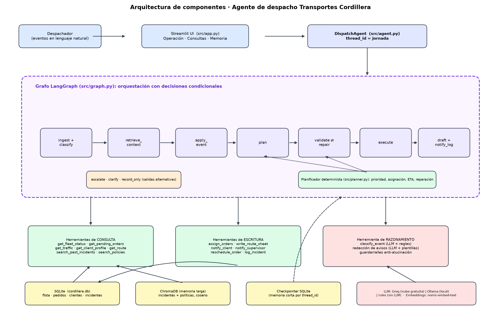
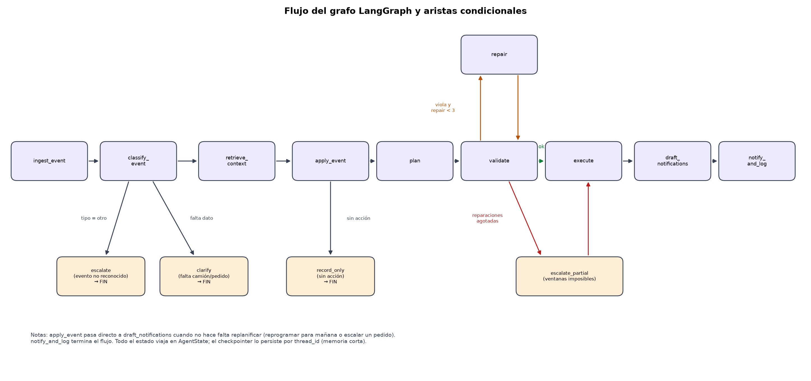
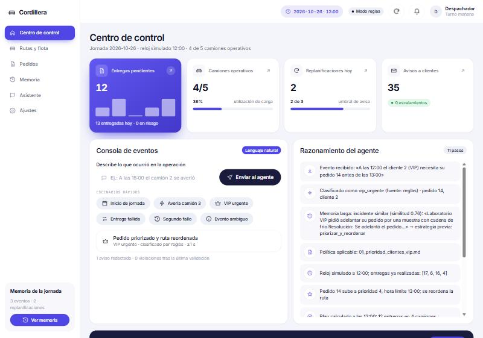
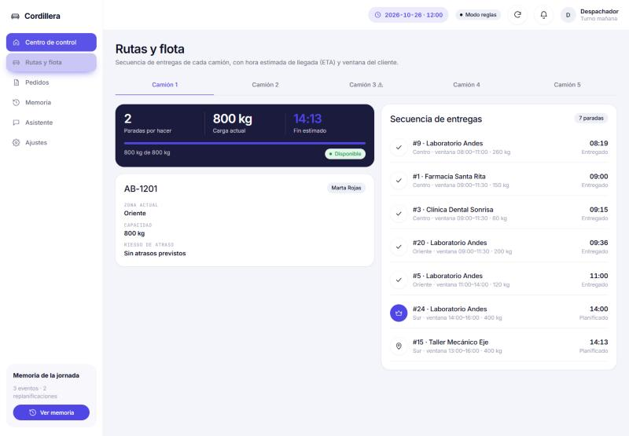

# 🚚 Agente de despacho y rutas · Transportes Cordillera

Evaluación Parcial 2 · ISY0101 Ingeniería de Soluciones con IA.
Agente funcional (LangGraph) que planifica y **replanifica** el reparto diario de una empresa de
transporte ficticia ante averías, clientes VIP urgentes y entregas fallidas. **Stack 100% gratuito.**

## 1. El problema
Transportes Cordillera asigna a mano los pedidos a sus camiones. Cuando un camión se avería, un
cliente VIP pide urgencia o una entrega falla, el plan del día se descuadra, se pierde el contexto
y los clientes no reciben avisos a tiempo.

## 2. Qué hace el agente
Recibe eventos en lenguaje natural («A las 11:00 el camión 3 se averió») y ejecuta un flujo:
**clasificar → recuperar memoria → actuar → planificar → validar/reparar → ejecutar → avisar → registrar**.

| Capacidad | Cómo |
|---|---|
| Herramientas de **consulta** | flota, pedidos, tráfico, perfil de cliente, rutas, búsqueda semántica de incidentes y políticas |
| Herramientas de **escritura** | asignar pedidos, hojas de ruta (`outputs/*.md`), avisos a clientes y supervisor, reprogramar, registrar incidentes |
| **Razonamiento** | clasificación de eventos (LLM + reglas + validación de ids) y redacción de avisos |
| Memoria **corta** | checkpointer SQLite de LangGraph, un `thread_id` por jornada |
| Memoria **larga** semántica | ChromaDB con incidentes pasados y políticas (embeddings `nomic-embed-text`) |
| **Planificación** | puntuación de urgencia, asignación con capacidad, secuenciación por ventana, validación y reparación |
| **Adaptación** | replan ante avería / VIP / entrega fallida; escalamiento al supervisor cuando corresponde |

## 3. Arquitectura




Más detalle: [orquestación](docs/orquestacion.md) · [planificación](docs/planificacion.md) ·
[decisiones de diseño](docs/decisiones.md) · [bocetos de la UI](docs/bocetos/boceto_ui.png).

## 4. Requisitos
- Python 3.11 – 3.13 (probado con 3.13)
- Node.js 18+ solo si quieres modificar o recompilar el panel (el repo incluye `frontend/dist` ya compilado)
- [Ollama](https://ollama.com) (opcional, para LLM local y **necesario para los embeddings reales**)
- Cuenta gratuita en [console.groq.com](https://console.groq.com) (opcional, LLM en la nube)

## 5. Instalación (Windows PowerShell)
```powershell
git clone <URL-DEL-REPO>
cd cordillera-dispatch-agent
py -m venv .venv
.\.venv\Scripts\Activate.ps1          # si falla: Set-ExecutionPolicy -Scope CurrentUser RemoteSigned
pip install -r requirements.txt
ollama pull nomic-embed-text           # embeddings (≈270 MB)
ollama pull qwen2.5:1.5b               # LLM local opcional (≈1 GB)
copy .env.example .env
```
Linux/macOS: `python3 -m venv .venv && source .venv/bin/activate` y `cp .env.example .env`.

## 6. Configuración (`.env`)
| Variable | Valores | Nota |
|---|---|---|
| `LLM_PROVIDER` | `groq` · `ollama` · `rules` | `rules` = sin LLM (determinista, offline) |
| `GROQ_API_KEY` | tu clave | solo para `groq`; **nunca la subas a Git** (`.env` está ignorado) |
| `GROQ_MODEL` | `llama-3.3-70b-versatile` | |
| `OLLAMA_MODEL` | `qwen2.5:1.5b` | cualquier modelo local con 8 GB de RAM |
| `OLLAMA_EMBED_MODEL` | `nomic-embed-text` | |
| `EMBEDDINGS_PROVIDER` | `ollama` · `fake` | `fake` = solo para pruebas sin Ollama |

## 7. Ejecución
```powershell
python data/seed.py                              # (opcional) crea la BD sintética; la API lo hace sola al iniciar
python -m uvicorn api.main:app --port 8000       # API + panel web en http://127.0.0.1:8000
pytest -v                                        # 57 pruebas, sin red ni LLM
python scripts/generate_evidence.py              # regenera docs/evidencia/ (escenarios paso a paso)
python scripts/make_diagrams.py                  # regenera los diagramas PNG (requiere matplotlib)
```
Cada vez que arranca el servidor comienza una **jornada limpia** (datos sintéticos + memoria reindexada);
`CORDILLERA_KEEP_STATE=1` conserva el estado anterior. Si Ollama no responde, la API degrada a embeddings
simplificados y el panel muestra un aviso de «modo degradado».

**Desarrollo del panel** (opcional, requiere Node):
```powershell
cd frontend
npm install
npm run dev        # http://localhost:5173 con proxy a la API en :8000
npm run build      # recompila frontend/dist (lo sirve FastAPI)
```
El panel usa el kit de componentes *fintech-ui-react* (tema `indigo`): `Sidebar`, `TopBar`, `KpiCard`,
`DataTable`, `ChartCard`/`ColumnChart`/`DonutChart`, `StatStrip`, `Tabs`, `FilterChips`, `Notice`,
`Dock` (móvil) y los tokens CSS del kit, sin dependencias de UI adicionales.

Uso por código:
```python
from src.agent import DispatchAgent
agent = DispatchAgent(thread_id="jornada-hoy")
state = agent.handle("Inicio de jornada")
state = agent.handle("A las 11:00 el camión 3 se averió en la Zona Norte")
print("\n".join(state["log"]))
```

## 8. Demo guiada (panel web)
1. **Inicio de jornada** → 25 entregas en 5 camiones, hojas de ruta y avisos.
2. **Avería camión 3** → el camión queda en rojo, sus pedidos se reasignan, se avisa a los afectados.
3. **VIP urgente pedido 14** → prioridad 4, entrega antes de las 12:00, ruta reordenada.
4. **Entrega fallida pedido 11** → reintento el mismo día; **segundo fallo** → escalado al supervisor.
5. **Evento ambiguo** → el agente pide datos o escala; nunca inventa un camión.
6. Sección **Memoria**: historial de la jornada, incidentes y búsqueda semántica (p. ej. «se me rompió una rueda»).
7. Sección **Asistente** (requiere `ollama` o `groq`): el LLM elige las herramientas de consulta por sí mismo.




## 9. Escenarios y evidencia de pruebas
| # | Escenario | Qué demuestra | Evidencia |
|---|---|---|---|
| 0 | Jornada normal | planificación con prioridades y validación | [md](docs/evidencia/escenario_0_jornada_normal.md) |
| 1 | Avería de camión | reasignación, nada se pierde, avisos | [md](docs/evidencia/escenario_1_averia.md) |
| 2 | Cliente VIP urgente | prioridad 4 + hora límite + reordenamiento | [md](docs/evidencia/escenario_2_vip_urgente.md) |
| 3 | Entrega fallida | reintento hoy → escalamiento al 2.º fallo | [md](docs/evidencia/escenario_3_entrega_fallida.md) |
| 4 | Memoria larga | recupera incidente parecido y su estrategia | [md](docs/evidencia/escenario_4_memoria_larga.md) |
| 5 | Cadena + memoria corta | 3 replanes → aviso de inestabilidad; estado persiste | [md](docs/evidencia/escenario_5_cadena_y_memoria_corta.md) |
| 6 | LLM caído | degradación a reglas y plantillas | [md](docs/evidencia/escenario_6_llm_caido.md) |
| 7 | Eventos ambiguos | pide datos, escala, descarta ids inventados | [md](docs/evidencia/escenario_7_eventos_ambiguos.md) |
| 8 | Plan imposible | 3 reparaciones y escalamiento | [md](docs/evidencia/escenario_8_plan_imposible.md) |

Las mismas condiciones se verifican automáticamente en [`tests/test_scenarios.py`](tests/test_scenarios.py).
Registro de `pytest`: [docs/evidencia/pytest.txt](docs/evidencia/pytest.txt). Ejecución con el LLM local real
(`qwen2.5:1.5b`): [docs/evidencia_ollama/](docs/evidencia_ollama/).

## 10. Documentos de la entrega
| Documento | Ubicación |
|---|---|
| Informe (plantilla Duoc UC, 5 páginas de contenido) | [docs/informe/Informe_EP2_ISY0101_Duoc.docx](docs/informe/Informe_EP2_ISY0101_Duoc.docx) |
| Presentación (plantilla Duoc UC, 13 láminas con notas del orador) | [docs/presentacion/Presentacion_EP2_Cordillera.pptx](docs/presentacion/Presentacion_EP2_Cordillera.pptx) |
| Guía simple del sistema (PDF con pantallazos, para no técnicos) | [docs/guia/Guia_Simple_del_Sistema.pdf](docs/guia/Guia_Simple_del_Sistema.pdf) |

Ambos se generan con `scripts/build_informe_duoc.py` y `scripts/build_presentacion.py` a partir de las plantillas
institucionales (`--template <ruta>`). Los datos que faltan (nombre del segundo integrante, docente, enlace del
repositorio, conclusiones y reflexiones) se completan directamente en los archivos.

## 11. Estructura del repositorio
```
├── data/            seed.py (datos sintéticos) · traffic.json · politicas/*.md
├── src/
│   ├── graph.py     grafo LangGraph (nodos y aristas condicionales)
│   ├── planner.py   planificador determinista
│   ├── memory.py    ChromaDB + checkpointer SQLite
│   ├── tools/       query.py · write.py · reasoning.py
│   ├── llm.py       Groq / Ollama / rules, embeddings
│   ├── qa_agent.py  agente ReAct de consultas (tool-calling)
│   └── agent.py · state.py · db.py · config.py · world.py
├── api/             main.py (FastAPI: expone el agente y sirve el panel)
├── frontend/        React + Vite con el kit fintech-ui-react (src/pages, src/components, dist/)
├── tests/           57 pruebas (unitarias, escenarios y API)
├── scripts/         generate_evidence.py · make_diagrams.py · build_informe_duoc.py · build_presentacion.py
└── docs/            diagramas · bocetos · evidencia · decisiones
```
