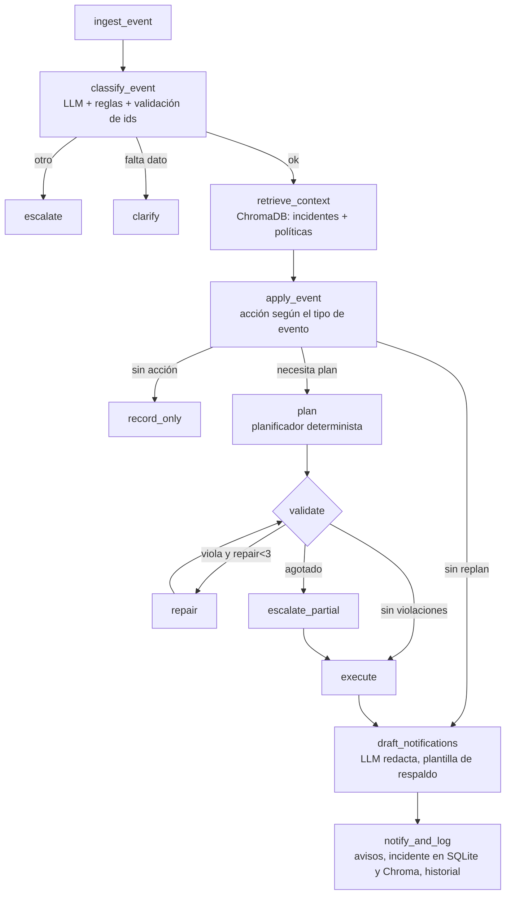
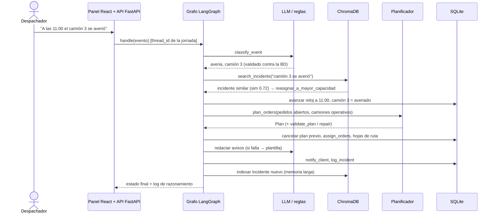

# Orquestación de componentes

## 1. Vista de componentes

| Capa | Módulo | Responsabilidad |
|---|---|---|
| Interfaz | `frontend/` (React + Vite) | Panel web con el kit *fintech-ui-react* (tema `indigo`): control, rutas, pedidos, memoria, asistente, ajustes |
| API | `api/main.py` (FastAPI) | Expone el agente por HTTP (`/api/events`, `/api/overview`, `/api/memory/search`, `/api/chat`…) y sirve el panel compilado |
| Fachada | `src/agent.py` | `DispatchAgent`: invoca el grafo con un `thread_id` por jornada |
| Orquestación | `src/graph.py`, `src/state.py` | Grafo LangGraph con aristas condicionales y estado tipado |
| Decisión | `src/planner.py` | Prioridad, asignación, secuenciación, validación y reparación (determinista) |
| Herramientas | `src/tools/query.py`, `write.py`, `reasoning.py` | Consulta, escritura y razonamiento |
| Memoria | `src/memory.py` | Checkpointer SQLite (corta) + ChromaDB (larga, semántica) |
| LLM | `src/llm.py` | Selector `groq` / `ollama` / `rules` y embeddings |
| Datos | `src/db.py`, `data/seed.py` | SQLite, geografía ficticia, tráfico simulado |
| Consultas | `src/qa_agent.py` | Agente ReAct (el LLM elige herramientas de solo lectura) |

## 2. Flujo del grafo

Diagrama exportado automáticamente por LangGraph: [`grafo_langgraph.mmd`](grafo_langgraph.mmd).

## 3. Secuencia de un escenario (avería de camión)

## 4. Memoria

| Tipo | Mecanismo | Qué guarda | Dónde se usa |
|---|---|---|---|
| Corta | `SqliteSaver` + `thread_id` | historial de eventos de la jornada, nº de replanificaciones | contar inestabilidad (≥3 replanes → aviso al supervisor), retomar tras reinicio |
| Larga | ChromaDB (coseno) + `nomic-embed-text` | incidentes pasados con su estrategia y resolución; políticas | sugerir estrategia (p. ej. reprogramar mañana para un cliente con ausencias), citar la política aplicable |

## 5. Tolerancia a fallos (degradación controlada)

| Falla | Reacción |
|---|---|
| LLM sin clave o caído | clasificación por reglas + plantillas de aviso |
| LLM clasifica mal | reglas de alta precisión prevalecen; `nuevo_dia` solo con confirmación de reglas |
| LLM inventa un id | se descarta contra la BD y se pide el dato |
| LLM redacta un aviso sin los datos exactos | se descarta y se usa plantilla |
| Embeddings / ChromaDB no disponibles | la búsqueda devuelve vacío; el flujo operativo continúa |
| Plan imposible | 3 intentos de reparación y luego escalamiento con el mejor plan posible |
